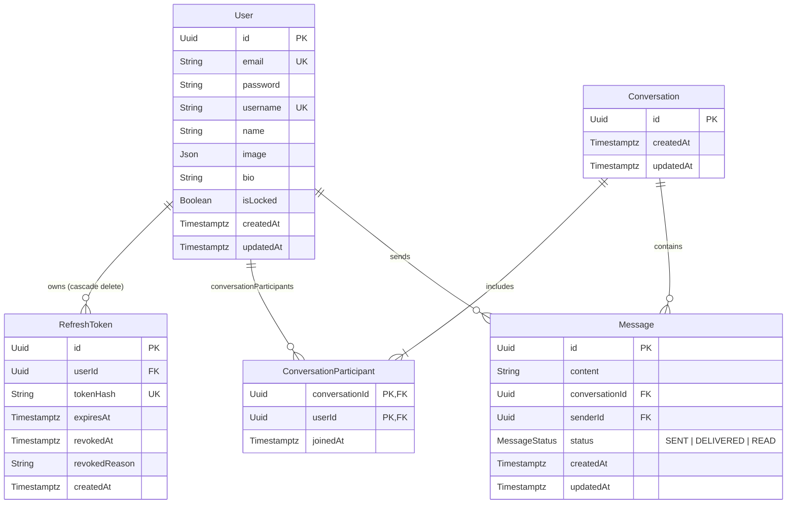

# SOUT (صوت)

> **Full-stack real-time messaging platform built with Next.js 16, Express 5, Prisma 8, PostgreSQL, Redis, and Socket.IO.**

---

> [!WARNING]
> ### Project Status: Under Active Development
> Core authentication, token rotation, real-time messaging, presence, and profile management are functional, while APIs and UI components continue to evolve toward v1.0.

---

## Overview

**SOUT** (Arabic for *Voice* or *Sound*) is a full-stack real-time messaging application structured as a clean monorepo:

- **Frontend ([`client/README.md`](./client/README.md)):** Next.js 16 App Router, React 19, Tailwind CSS v4, TanStack React Query v5, Zustand, Motion, WebGL2 `FloatingLines` shader backgrounds, custom SVG/CSS components (`BranchedMenu`, `SlingButton`, `ThoughtLine`), and custom typography (`FKRasterRoman`, `KHInterference`, `KHTeka`).
- **Backend ([`server/README.md`](./server/README.md)):** Express 5, TypeScript 6, Prisma 8 (`@prisma/orm-postgres`), PostgreSQL, Redis (`ioredis`), Socket.IO 4, Zod 4, Multer + Cloudinary, Nodemailer.

---

## Tech Stack

### Frontend (`/client`)
- **Framework & Styling:** Next.js 16 (App Router, Turbopack), React 19, Tailwind CSS v4
- **Custom UI & Motion:** `motion/react` (`SlingButton`), WebGL2 (`FloatingLines`), SVG (`BranchedMenu`), CSS Shimmer (`ThoughtLine`)
- **Data & Real-Time:** TanStack React Query v5, Zustand v5, `socket.io-client`
- **Icons & Notifications:** `lucide-react`, `react-hot-toast`

### Backend (`/server`)
- **Server & Language:** Node.js (ESM), Express 5, TypeScript 6 (`tsx`)
- **Database & Cache:** PostgreSQL 15+ (Prisma 8 contract runtime), Redis (`ioredis`)
- **Real-Time & Auth:** Socket.IO 4 (cookie handshake), JWT + SHA-256 refresh token rotation with PostgreSQL row-level locking (`FOR NO KEY UPDATE`)
- **Validation, Media & Mail:** Zod 4, Multer + Cloudinary, Nodemailer

---

## Database Schema & ERD

Defined via **Prisma 8 contracts** ([`server/src/prisma/contract.prisma`](./server/src/prisma/contract.prisma)) with a standalone PlantUML diagram in [`erd.puml`](./erd.puml).



---

## Key Features

- **Authentication & Session Security:**
  - Two-step email registration + OTP verification stored in Redis.
  - `HttpOnly`, `SameSite=Lax` access (`15m`) and refresh (`7d`) cookies with atomic single-use rotation and row-level concurrency locks.
  - Forgot/reset password flow and active session revocation (`logout` / `logoutAll`).
- **Real-Time Messaging & Presence:**
  - Authenticated Socket.IO gateway with live direct messaging, typing indicator (`ThoughtLine`), online presence, and `SENT` / `DELIVERED` / `READ` receipts.
- **Profile & Settings:**
  - Bento-style `/profile` and `/profile/settings` pages with dynamic avatar aura, avatar upload/removal, bio & username updates, and 2-step email change (current email OTP + new email OTP).
- **Resilient Frontend Networking:**
  - Automatic `401` interception and in-flight refresh deduplication in `client/lib/request.ts` backed by TanStack Query.

---

## Repository Structure

```text
SOUT/
├── client/                         # Next.js 16 Frontend (see client/README.md)
│   ├── app/                        # /, /login, /register, /profile, /profile/settings, not-found
│   ├── components/                 # background/, chat/, profileSettings/, forgotPassword/, modals/, BranchedMenu, AppShell
│   ├── features/                   # API client modules
│   ├── hooks/                      # React Query hooks
│   ├── stores/                     # Zustand stores
│   └── lib/                        # request.ts, socket.ts
│
├── server/                         # Express 5 Backend (see server/README.md)
│   ├── src/
│   │   ├── config/                 # Cloudinary, Mail, Redis configs
│   │   ├── middlewares/            # Auth, Multer, Zod validate, Error handler
│   │   ├── modules/                # auth, user, conversation, message
│   │   ├── prisma/                 # contract.prisma & db.ts
│   │   ├── utils/                  # cloudinary/, errors/, mail/, otp/, password/, redis/, tokens/
│   │   ├── socket.ts               # Socket.IO gateway
│   │   └── index.ts                # Server entrypoint
│   └── migrations/
│
├── erd.puml                        # PlantUML Entity-Relationship Diagram
├── system_design.puml              # System architecture diagram
└── README.md                       # Combined project documentation
```

---

## Getting Started

### Prerequisites
- **Node.js** v20+
- **PostgreSQL** v15+
- **Redis** v6+

### 1. Backend (`http://localhost:5000`)
```bash
cd server
npm install
cp .env.example .env
npx prisma db push
npm run dev
```

### 2. Frontend (`http://localhost:5001`)
```bash
cd client
npm install
cp .env.example .env.local
npm run dev
```

---

## Roadmap

- [x] Prisma 8 database contract & PostgreSQL migrations
- [x] Dual-token auth with atomic rotation & concurrency locks
- [x] Real-time messaging, typing indicator, read receipts & presence
- [x] Custom UI system (`FloatingLines`, `BranchedMenu`, `SlingButton`, `ThoughtLine`, custom branding & 404)
- [x] Profile & 2-step email/password settings
- [ ] Group conversations & chat media attachments
- [ ] Push notifications & end-to-end test suite

---

## License

Private / proprietary. All rights reserved.
