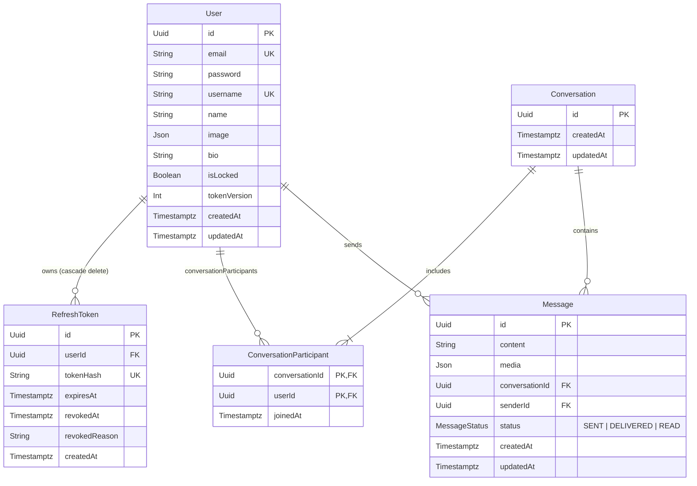

# SOUT (صوت)

> **Full-stack cross-platform real-time messaging platform built with Next.js 16, Capacitor 8, Express 5, Prisma 8, PostgreSQL, Redis, Socket.IO, and Cloudflare R2.**

---

> [!WARNING]
> ### Project Status: Under Active Development
> Authentication, `tokenVersion` cross-device session revocation, real-time messaging, voice notes, Cloudflare R2 media sharing, presence, profile management, and the Capacitor Android build are functional while APIs and UI continue evolving toward v1.0.

---

## Overview

**SOUT** (Arabic for *Voice* or *Sound*) is a full-stack real-time communication platform organized as a 3-app monorepo:

- **Web Client ([`client/README.md`](./client/README.md)):** Next.js 16 App Router (`/` landing page, `/chat` workspace, `/login`, `/register`, `/profile`, `/profile/settings`), React 19, Tailwind CSS v4, TanStack React Query v5, Zustand v5, WebGL2 `FloatingLines` shader backgrounds, custom UI components (`BranchedMenu`, `SlingButton`, `ThoughtLine`, `VoiceMessage`, `CustomAudioPlayer`), and custom typography (`Geist`, `FKRasterRoman`, `KHInterference`, `KHTeka`).
- **Mobile App ([`mobile/README.md`](./mobile/README.md)):** Capacitor 8 Android (and iOS-ready) app wrapping a static Next.js 16 export (`output: "export"`), direct `/chat` / `/login` entry flow, native microphone permissions for voice notes, and a custom SOUT adaptive vector launcher icon.
- **Backend Server ([`server/README.md`](./server/README.md)):** Express 5, TypeScript 6, Prisma 8 (`@prisma/orm-postgres`), PostgreSQL, Redis (`ioredis`), Socket.IO 4, Zod 4, Multer + `sharp` + Cloudflare R2 (`@aws-sdk/client-s3`), and Nodemailer.

---

## Tech Stack

### Web & Mobile (`/client`, `/mobile`)
- **Framework & Native Bridge:** Next.js 16 (App Router, Turbopack), React 19, Tailwind CSS v4, Capacitor 8 (`@capacitor/android`)
- **Custom UI & Motion:** `motion/react` (`SlingButton`), WebGL2 (`FloatingLines`), SVG (`BranchedMenu`), CSS Shimmer (`ThoughtLine`), MediaRecorder (`VoiceMessage`, `CustomAudioPlayer`)
- **Data & Real-Time:** TanStack React Query v5, Zustand v5, `socket.io-client` v4
- **Icons & Notifications:** `lucide-react`, `react-hot-toast`

### Backend (`/server`)
- **Server & Language:** Node.js (ESM), Express 5, TypeScript 6 (`tsx`)
- **Database & Cache:** PostgreSQL 15+ (Prisma 8 contract runtime), Redis (`ioredis` v6)
- **Real-Time & Auth:** Socket.IO 4 (cookie + `tokenVersion` handshake, multi-session `user:<id>` rooms, `force_logout`), JWT + SHA-256 single-use refresh token rotation with PostgreSQL `FOR NO KEY UPDATE` row locks
- **Validation, Media & Mail:** Zod 4, Multer + `sharp` + Cloudflare R2 (`@aws-sdk/client-s3`), Nodemailer

---

## Database Schema & ERD

Defined via **Prisma 8 contracts** ([`server/src/prisma/contract.prisma`](./server/src/prisma/contract.prisma)) with a standalone PlantUML diagram in [`erd.puml`](./erd.puml).



---

## Key Features

- **Production-Grade Auth & Cross-Device Session Security:**
  - Two-step email registration + Redis-backed OTP verification, plus automatic email normalization (`.trim().toLowerCase()`) and strict lowercase usernames.
  - `HttpOnly` access (`15m`) and single-use SHA-256 refresh (`7d`) cookies with atomic PostgreSQL row-level locking (`FOR NO KEY UPDATE`).
  - Instant cross-device revocation using `User.tokenVersion` (incremented atomically on `logoutAll`, `changePassword`, and `resetPassword`) paired with real-time Socket.IO `force_logout` broadcasts + socket disconnection.
  - Security email notifications on password resets and password changes.
- **Real-Time Messaging, Voice Notes & Media:**
  - Multi-session Socket.IO gateway (`user:<userId>` rooms) with live messaging, online presence, shimmering typing indicator (`ThoughtLine`), live voice-recording indicator, catch-up delivery, and `SENT` / `DELIVERED` / `READ` receipts.
  - In-chat browser/mobile voice note recording (`VoiceMessage`) and playback (`CustomAudioPlayer`).
  - Cloudflare R2 media uploads (`IMAGE`, `VIDEO`, `AUDIO`, `DOCUMENT`) with optimistic chat previews.
- **Profile & Account Controls:**
  - Bento-style `/profile` and `/profile/settings` pages with dynamic avatar aura, R2 avatar upload/removal, bio & username updates, 2-step email change (current email OTP + new email OTP), password change, session management, and account deletion.
- **Resilient Frontend Networking:**
  - Automatic `401` interception with shared in-flight refresh deduplication (`request.ts`) backed by TanStack React Query.

---

## Repository Structure

```text
SOUT/
├── client/                         # Next.js 16 Web App (see client/README.md)
│   ├── app/                        # / (landing), /chat, /login, /register, /profile, /profile/settings, not-found
│   ├── components/                 # landingPage/, background/, chat/, profileSettings/, forgotPassword/, modals/, ui/, AppShell
│   ├── features/                   # Typed API client modules
│   ├── hooks/                      # React Query hooks
│   ├── middleware/                 # redirect.middleware.ts (via proxy.ts)
│   ├── stores/                     # Zustand stores
│   └── lib/                        # request.ts, socket.ts, utils.ts
│
├── mobile/                         # Capacitor 8 Mobile App (see mobile/README.md)
│   ├── android/                    # Native Android Studio project (custom icon & mic permissions)
│   ├── app/                        # Static-exported Next.js routes (/ -> /chat or /login)
│   ├── capacitor.config.ts         # Capacitor configuration (com.sout.app)
│   └── next.config.ts              # output: "export", trailingSlash: true
│
├── server/                         # Express 5 Backend (see server/README.md)
│   ├── src/
│   │   ├── config/                 # r2.config.ts, mail.config.ts, redis.config.ts
│   │   ├── middlewares/            # auth (JWT + tokenVersion), multer, Zod validate, error handler
│   │   ├── modules/                # auth, user, conversation, message
│   │   ├── prisma/                 # contract.prisma & db.ts
│   │   ├── utils/                  # r2/, errors/, mail/, otp/, password/, redis/, tokens/
│   │   ├── socket.ts               # Socket.IO gateway & forceLogoutAllSessions
│   │   └── index.ts                # Express + HTTP + Socket.IO entrypoint
│   └── migrations/
│
├── erd.puml                        # PlantUML Entity-Relationship Diagram
├── system_design.puml              # System architecture diagram
└── README.md                       # Root project documentation
```

---

## Getting Started

### Prerequisites
- **Node.js** v20+
- **PostgreSQL** v15+
- **Redis** v6+
- **Cloudflare R2** bucket (for avatars, voice notes, and chat media)
- **Android Studio** *(optional — for building the Capacitor Android app in `mobile/`)*

### 1. Backend (`http://localhost:5000`)
```bash
cd server
npm install
cp .env.example .env
npx prisma db push
npm run dev
```

### 2. Web Client (`http://localhost:5001`)
```bash
cd client
npm install
cp .env.example .env.local
npm run dev
```

### 3. Mobile App (Android / Capacitor)
```bash
cd mobile
npm install
npm run build
npx cap sync android
adb reverse tcp:5000 tcp:5000   # for local emulator or USB phone testing
npx cap open android
```
See [`mobile/README.md`](./mobile/README.md) for the full APK build and HTTPS production checklist.

---

## Roadmap

- [x] Prisma 8 database contract & PostgreSQL migrations
- [x] Dual-token auth with atomic rotation, `tokenVersion` revocation & Socket.IO `force_logout`
- [x] Real-time messaging, typing & recording indicators, read receipts & multi-session presence
- [x] Voice notes & chat media attachments via Cloudflare R2
- [x] Landing page (`/`), custom UI system (`FloatingLines`, `BranchedMenu`, `SlingButton`, `ThoughtLine`, custom 404)
- [x] Profile, 2-step email/password settings & account deletion
- [x] Capacitor 8 Android mobile app with custom adaptive icon
- [ ] Group conversations
- [ ] Push notifications (FCM / APNs) & end-to-end test suite

---

## License

Private / proprietary. All rights reserved.
